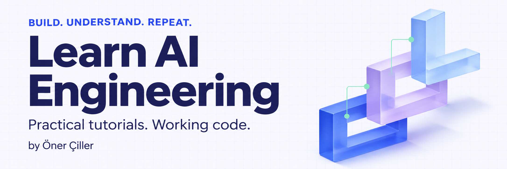

Practical AI engineering tutorials by [Öner Çiller](https://onerciller.substack.com).

## Tutorials

| Tutorial | Examples | Language |
| --- | --- | --- |
| [Understanding MCP](tutorials/mcp/) | Five parts: tools, resources, prompts, user input, security, retries, and gateways | Go |
| [How LLM Applications Work](tutorials/llm-applications/) | Five parts: requests, context, structured output, streaming, and MCP tools | Go |
| [Build Your First AI Agent](tutorials/first_agent/) | Five runnable parts: tool calls, agent loop, stopping rules, approval, and Go MCP connection | Python |

All lesson code lives in `tutorials/`. Go lessons share one root `go.mod` and
`go.sum`; Python lessons share one root `pyproject.toml` and `uv.lock`.
Run every command below from the repository root.

```text
learn-ai-engineering/
├── go.mod / go.sum                  Go dependencies (Go 1.25.0 baseline)
├── pyproject.toml / uv.lock         Python dependencies
├── .python-version                 Python 3.12.11
├── .env.example                    OpenRouter configuration names
├── Makefile                        Root run, setup and check commands
├── tutorials/
│   ├── mcp/part-1/ … part-5/       Existing Go MCP examples
│   ├── llm-applications/part-1/ …  Existing Go LLM examples
│   ├── first_agent/part_01/ …      Five runnable Python agent lessons
│   └── <python_series>/part_01/    New Python lessons, added when written
├── tests/                          Python tests; Go tests stay beside each lesson
└── templates/python-part/          Starter for new Python lessons
```

## Run from the root

```sh
# Go lesson
make run-go SERIES=mcp PART=1
# Equivalent native command:
go run ./tutorials/mcp/part-1

# Python agent: simulated model and real local tool by default
make run-python SERIES=first_agent PART=01
make run-python SERIES=first_agent PART=01 ARGS='--demo-tool --query launch'

# Run Python demos against local tools and the real Go MCP server:
make demo-agent
# Interactive approval before saving a simulated email draft:
make run-python SERIES=first_agent PART=04
# Verify both the Go and Python agents against the MCP server:
make integration
make integration-agent

# Check every Go package and the shared Python code:
make test
```

`make setup` downloads the pinned Go dependencies and syncs the locked Python
environment. `make help` lists commands. Pass lesson flags with `ARGS='...'`.
All five Python parts are implemented. Default demos use a simulated model;
add `ARGS='--live'` to call OpenRouter with an explicitly configured model.
See the [agent guide](tutorials/first_agent/README.md) for setup and verification
limits. Real model calls have not been verified.

Start with the [MCP guide](tutorials/mcp/README.md) for Inspector instructions.
The [repository migration guide](docs/repository-layout.md) maps the old paths.

## Shared Python environment

New tutorials use Python with one shared, locked environment. The existing Go
series above remain unchanged.

```sh
uv sync --locked
uv run --locked python -m tutorials.first_agent
```

Use Python **3.12.11** and uv **0.7.12**. Setup, folder conventions, dependency
updates and checks: [Python setup](docs/python-setup.md).
Starter files: [templates/python-part](templates/python-part/).
